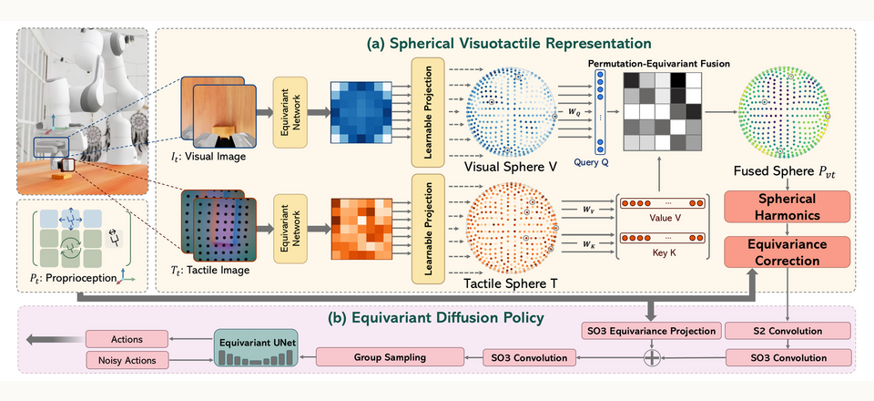
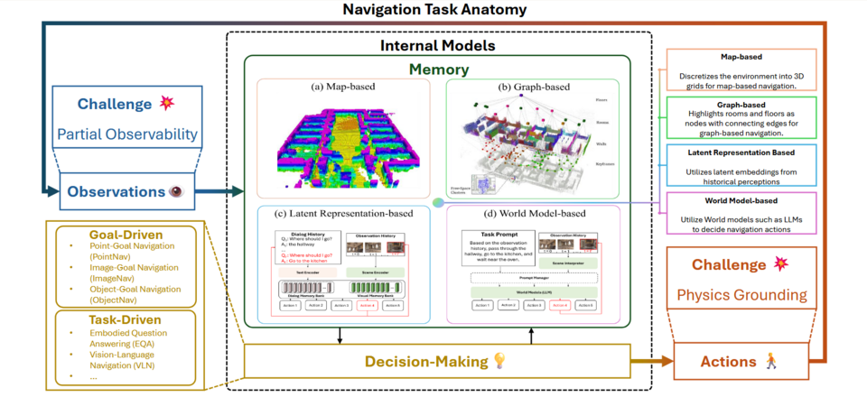

<h1 align="center">Wong Lik Hang Kenny</h1>

<strong>Embodied AI · Visuotactile Perception · Robot Learning</strong>

  Master's student in Computer Science and Engineering at <a href="https://www.cuhk.edu.hk/">The Chinese University of Hong Kong</a>, working in <a href="https://www.cse.cuhk.edu.hk/~qdou/">Prof. Qi Dou's lab</a>. 
  I build learning systems that help robots reason through contact and manipulate the physical world reliably.

  
  

## Connect

  &nbsp;&nbsp;
  &nbsp;&nbsp;
  &nbsp;&nbsp;
  &nbsp;&nbsp;
  &nbsp;&nbsp;
  &nbsp;&nbsp;
  

  <strong>Discord:</strong> <code>wonglikhangkenny</code>  
  <a href="https://kenn3o3.github.io/images/wechat-qr.png">WeChat</a> ·
  <a href="https://scholar.google.com/citations?hl=en&amp;user=x0JaFVIAAAAJ&amp;view_op=list_works&amp;sortby=pubdate">Google Scholar</a> ·
  <a href="https://orcid.org/0009-0004-3599-1649">ORCID</a> ·
  <a href="https://github.com/Kenn3o3">GitHub</a> ·
  <a href="https://www.linkedin.com/in/kennywlh">LinkedIn</a> ·
  <a href="https://x.com/kennywonglh">X</a>

  <code>Visuotactile Learning</code>&nbsp;&nbsp;
  <code>Contact-rich Manipulation</code>&nbsp;&nbsp;
  <code>Diffusion / Flow Policies</code>&nbsp;&nbsp;
  <code>3D Vision</code>

## Selected research

<table>
  <tr>
    <td width="50%" valign="top">
      
      <h3>VISTA</h3>
      
<strong>CoRL 2026</strong> · Equivariant Visual-Tactile Diffusion Policy for Contact-Rich Manipulation

      
Fuses visual and tactile observations on the sphere to learn spatially robust manipulation policies.

      
<a href="https://vista-paper.github.io/">Project</a> · <a href="https://github.com/Kenn3o3/Vista">Code</a> · <a href="https://kenn3o3.github.io/projects/vista">Overview</a>

    </td>
    <td width="50%" valign="top">
      
      <h3>Physics Simulators for Embodied AI</h3>
      
<strong>ACM Computing Surveys</strong>

      
A structured survey of simulation platforms for robotic navigation and manipulation.

      
<a href="https://arxiv.org/abs/2505.01458">Paper</a> · <a href="https://kenn3o3.github.io/projects/eai-survey">Overview</a>

    </td>
  </tr>
</table>

  <em>Always happy to talk about robots that learn from sight, touch, and interaction.</em>  
  <a href="mailto:klhwong3@outlook.com"><strong>Get in touch →</strong></a>

